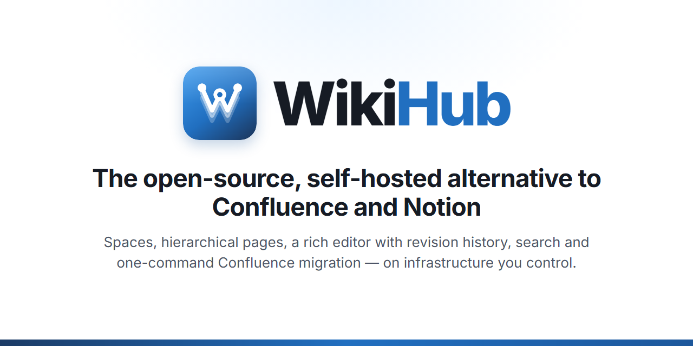
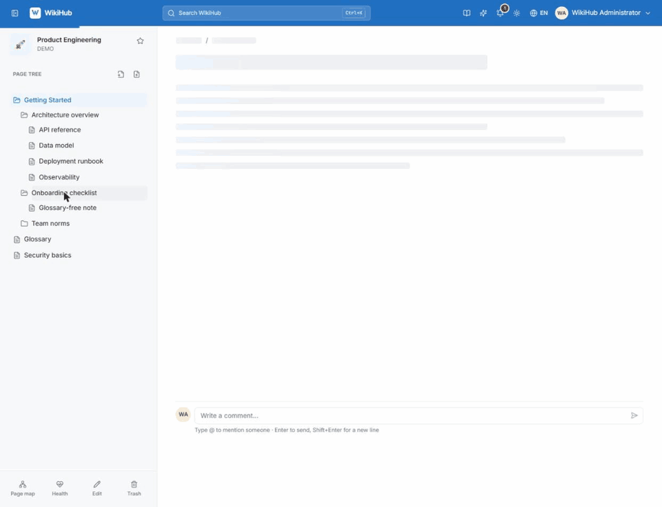
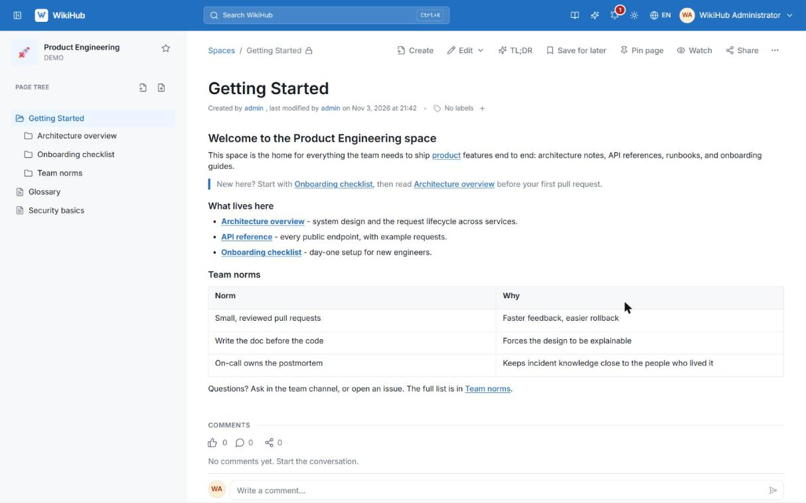
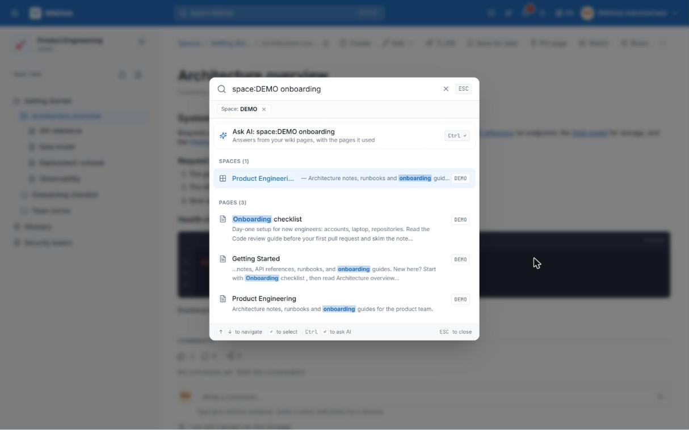
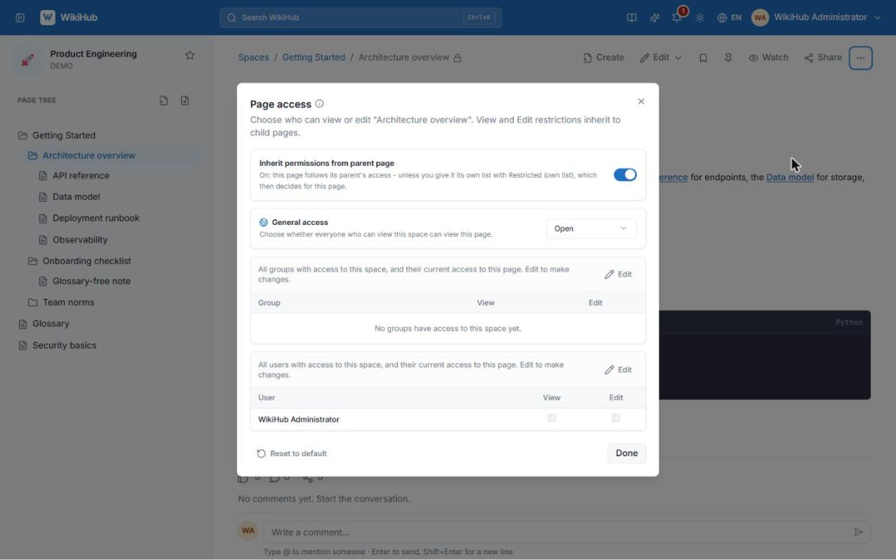
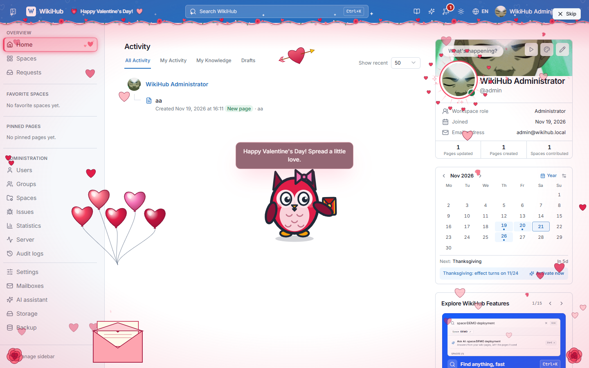

<div align="center">



# WikiHub

**The open-source, self-hosted alternative to Confluence and Notion.**<br>
Spaces, hierarchical pages, a rich editor with revision history, attachments, Confluence migration, offline export, and an optional AI assistant — all on infrastructure you control.<br>
No per-seat pricing. No vendor lock-in.

[](https://github.com/QuanBlue/wiki-hub/stargazers)
[](https://github.com/QuanBlue/wiki-hub/network/members)
[](https://github.com/QuanBlue/wiki-hub/commits/master)
[](LICENSE)


**English** · [Tiếng Việt](README.vi.md) · **[Website](https://quanblue.github.io/wiki-hub/)** · [Demo & Screenshots](docs/demo) · [Issues](https://github.com/QuanBlue/wiki-hub/issues)

<p align="center">
  
</p>

</div>

## Why WikiHub

- **Self-hosted & free.** Apache-2.0 open source with no per-seat pricing; your team's knowledge stays on your own servers.
- **One-command Docker setup.** `./scripts/run.sh` creates `.env`, resolves host-port conflicts, runs migrations, seeds the admin account, and brings the stack up.
- **First-class Confluence migration.** Import real Confluence XML or HTML space exports into structured Spaces and Pages with a live progress report, or export back to Confluence XML, Markdown, HTML, PDF, or Word.
- **Fine-grained access control.** Open or Restricted spaces, per-user and per-group grants, page-level inheritance and allow-lists, plus an Effective Permissions view.
- **Security built in.** Argon2id passwords, rotating JWTs, optional TOTP 2FA with recovery codes, audited admin impersonation, and strict MIME/magic-byte upload validation.
- **Optional AI assistant (BYO endpoint).** Connect any OpenAI-compatible API for cited Q&A, streaming chat, page drafting, TL;DR summaries, translation, and hybrid semantic search (with optional self-hosted Ollama). Zero overhead when disabled.
- **English & Vietnamese.** Instant top-bar language switch without reload, 18 built-in EN/VI templates, and accent-insensitive search.

## Features

**Knowledge & editing**

- [Spaces & pages](docs/demo#a-page-rendered): nested page trees, drag-and-drop moves, favorites, and Trash with configurable retention
- [Rich-text editor](docs/demo#editing-a-page): Tiptap WYSIWYG with `/` slash commands, tables, code blocks, callouts, toggles, and raw Markdown/HTML mode
- **Page templates**: 18 built-in EN/VI templates, global & per-space templates, and one-click *Save as template*
- [Revisions & drafts](docs/demo#drafts--recovery): immutable version history, visual diffs, non-destructive restore, and auto-saved drafts
- **Comments**: threaded replies, `@mentions` with notifications, likes, and discussion filters
- **Attachments & Office editing**: images, video (subtitles & PiP), PDFs, and in-place Word/Excel/PowerPoint editing via ONLYOFFICE

**Search, import & export**

- [Search & commands](docs/demo#global-search-shortcuts--commands): `Ctrl`/`⌘`+`K` accent-insensitive search, **Go to** navigation, and `:commands` (`:help`, `:trash`, `:chat`, `:ask`)
- **Document import**: batch-import Word, PDF, Excel, CSV, HTML, Markdown, EPUB, ODT, RTF, or shared Google Docs/Sheets links, with optional AI review & translation
- [Confluence import & export](docs/demo#backup--migration): XML and HTML space imports with unsupported-macro reports; Confluence Data Center XML export
- **Offline export**: export a page, subtree, Space, or entire instance to Markdown/HTML ZIP, PDF, or Word (`.docx`)

**AI assistant (optional)**

- [Cited Q&A & chat](docs/demo#ai-features): streaming multi-turn chat grounded in pages you can read and attached files, optional web search, and confirmation-gated actions
- **Reading & writing tools**: one-click TL;DR, *Create page with AI*, `Ctrl`+`Space` in-editor assistant, selection explain/translate, and label/related-page suggestions
- **Knowledge graph & content health**: related-page map, stale-page detection, broken links, orphans, duplicates, and unanswered questions
- **Hybrid & semantic search**: keyword + vector ranking via any OpenAI-compatible endpoint or UI-managed self-hosted Ollama

**Administration & workspace**

- [Permissions & auth](docs/demo#permissions--access-control): RBAC, Effective Permissions, TOTP 2FA, audited account impersonation, and audit logs
- [Backups & operations](docs/demo#backup--migration): scheduled resumable backups, read-only server/container monitor, usage statistics, SMTP mail, and an issue tracker with Word export
- [Branding & polish](docs/demo#theme--branding): custom themes & logos, editable EN/VI sign-in page, system announcements, personal status, welcome & [seasonal effects](docs/demo#seasonal-effects--festivals)

<table>
  <tr>
    <td></td>
    <td></td>
  </tr>
  <tr>
    <td></td>
    <td></td>
  </tr>
</table>

**[Every feature in detail, with screenshots →](docs/demo)**

## Quick start

Requires **Docker 24+** and **Docker Compose v2**.

```bash
./scripts/run.sh --dev   # development with hot reload
./scripts/run.sh         # production-like build
```

Run `./scripts/run.sh --help` for all flags (`--fresh`, `--rebuild`, `--no-build`, `--logs`, `--stop`).

| Service | Default URL |
|---|---|
| Frontend | http://localhost:3000 |
| API docs (Swagger / ReDoc) | http://localhost:8000/docs · `/redoc` |
| Health / readiness | http://localhost:8000/health · `/ready` |
| MinIO console | http://localhost:9001 |

### Deploy with prebuilt images

Prebuilt `linux/amd64` images are published to GHCR on every push to `master` (`ghcr.io/quanblue/wiki-hub-backend` and `ghcr.io/quanblue/wiki-hub-frontend`). On a server without the source tree, copy [`docker-compose.release.yml`](docker-compose.release.yml) and `.env` (from [`.env.example`](.env.example)), set your secrets, `WIKIHUB_ENV=production`, `WIKIHUB_CORS_ORIGINS`, and `NEXT_PUBLIC_ONLYOFFICE_DOCUMENT_SERVER_URL`, then run:

```bash
docker compose -f docker-compose.release.yml pull
docker compose -f docker-compose.release.yml up -d
```

## Development

To run the app outside Docker (requires Python 3.12+ and Node.js 20+):

```bash
make deps              # postgres + redis + minio in Docker
make install           # backend virtualenv
make install-frontend  # npm install

make dev-backend       # http://localhost:8000
make dev-worker        # background job worker
make dev-frontend      # http://localhost:3000
```

### Migrations & tests

```bash
make migrate                        # apply Alembic migrations (Docker)
make migration m="add page labels"  # autogenerate a new revision
make seed                           # bootstrap admin + demo content

./scripts/test.sh                   # full test suite + coverage
./scripts/test.sh --unit            # fast unit tests (no DB required)
make check                          # lint, typecheck, and tests
make e2e                            # Playwright end-to-end tests
```

## Tech Stack

| Layer | Technology |
|---|---|
| Backend | Python 3.12 · FastAPI · Pydantic v2 · SQLAlchemy 2 (async) · Alembic · structlog |
| Frontend | Next.js 16 (App Router) · React 19 · TypeScript · Tailwind CSS v4 · Radix UI · TanStack Query |
| Editor & Docs | Tiptap 3 · CodeMirror 6 · Mermaid · ONLYOFFICE Document Server · Pandoc · PyMuPDF · openpyxl · python-docx |
| Data & Storage | PostgreSQL 16 (full-text search) · Redis 7 · arq (async jobs) · MinIO / S3 |
| Auth & Security | Argon2id · JWT (rotating refresh tokens) · TOTP 2FA · `nh3` HTML sanitizer |
| AI (optional) | Any OpenAI-compatible chat & embedding endpoint · self-hosted Ollama |
| Testing & Deploy | pytest · Vitest · Playwright · Ruff · mypy · ESLint · Docker Compose |

## Documentation

| Document | Contents |
|---|---|
| [`docs/demo/`](docs/demo) | Full feature tour with screenshots and GIFs |
| [`docs/architecture.md`](docs/architecture.md) | System design and module layout |
| [`docs/knowledge-graph-and-rag.md`](docs/knowledge-graph-and-rag.md) | Search, knowledge graph, and AI retrieval |
| [`docs/development.md`](docs/development.md) | Day-to-day workflow and conventions |
| [`docs/design-system.md`](docs/design-system.md) | Visual language and layout tokens |
| [`docs/user-guide.md`](docs/user-guide.md) | Hướng dẫn sử dụng WikiHub (Tiếng Việt) |
| [`docs/licensing.md`](docs/licensing.md) | Third-party license obligations |
| [`docs/adr/`](docs/adr/) | Architecture decision records |

## License

WikiHub is free software under the [Apache-2.0 License](LICENSE).

WikiHub is an independent project and is not affiliated with, endorsed by, sponsored by, or derived from Atlassian or Notion Labs, Inc. "Confluence" and "Notion" are trademarks of their respective owners and are used strictly for comparative and interoperability purposes.

If WikiHub saves your team time, a ⭐ on GitHub helps a lot!

## Star History

<a href="https://www.star-history.com/?repos=QuanBlue%2Fwiki-hub&type=date&legend=top-left">
 <picture>
   <source media="(prefers-color-scheme: dark)" srcset="https://api.star-history.com/chart?repos=QuanBlue/wiki-hub&type=date&theme=dark&legend=top-left" />
   <source media="(prefers-color-scheme: light)" srcset="https://api.star-history.com/chart?repos=QuanBlue/wiki-hub&type=date&legend=top-left" />
   
 </picture>
</a>

---

<div align="center">

GitHub [@QuanBlue](https://github.com/QuanBlue) · Email [quannguyenthanh558@gmail.com](mailto:quannguyenthanh558@gmail.com)

</div>
