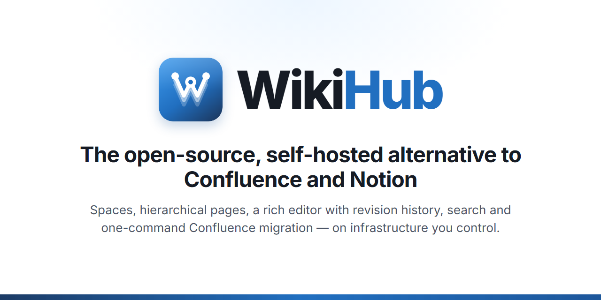
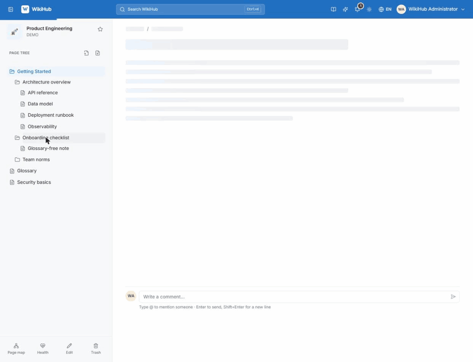
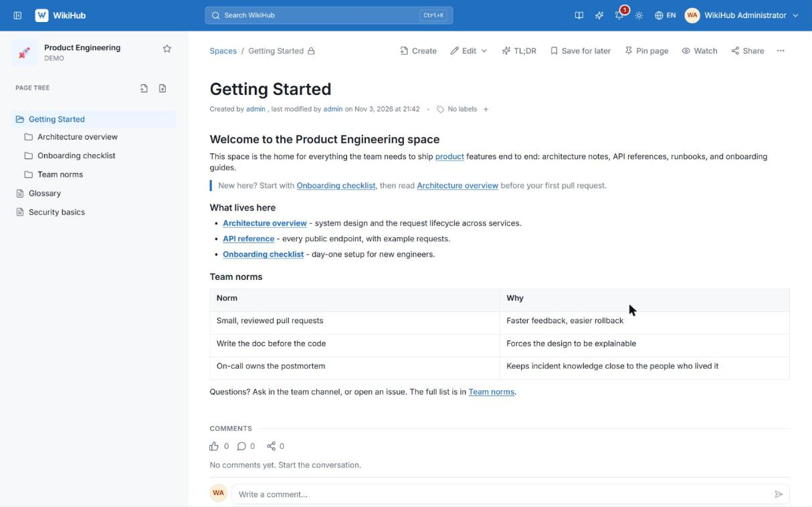
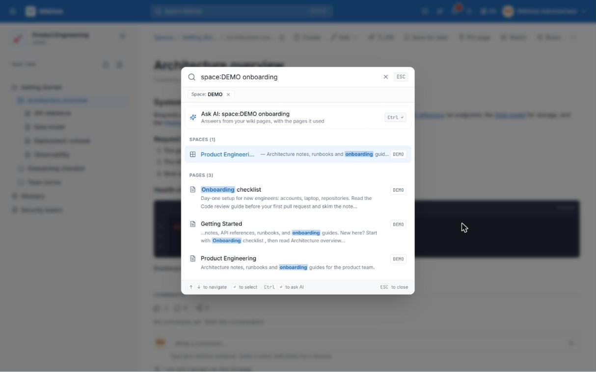
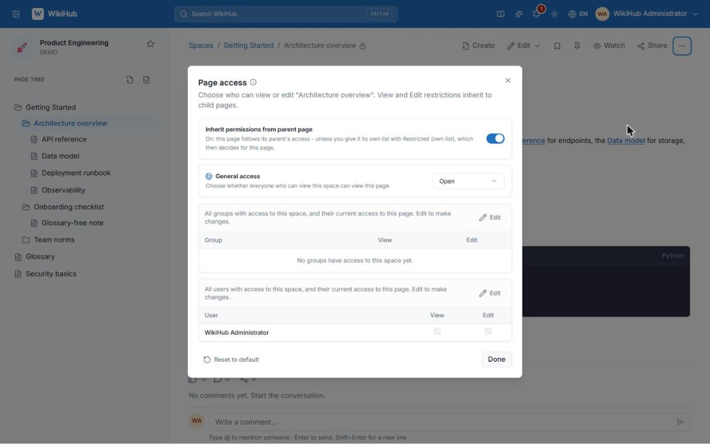
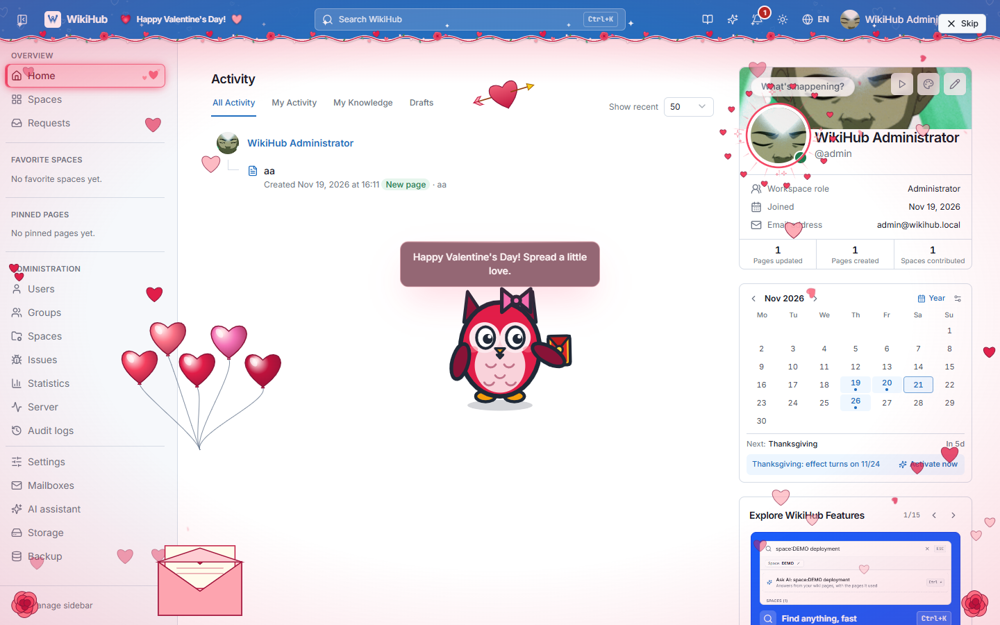

<div align="center">



# WikiHub

**Giải pháp mã nguồn mở, tự host thay thế Confluence và Notion.**<br>
Spaces, trang phân cấp, trình soạn thảo phong phú có lịch sử phiên bản, tệp đính kèm, nhập dữ liệu từ Confluence, xuất tài liệu ngoại tuyến và trợ lý AI tùy chọn — tất cả trên hạ tầng do bạn kiểm soát.<br>
Không tính phí theo người dùng. Không bị ràng buộc nhà cung cấp.

[](https://github.com/QuanBlue/wiki-hub/stargazers)
[](https://github.com/QuanBlue/wiki-hub/network/members)
[](https://github.com/QuanBlue/wiki-hub/commits/master)
[](LICENSE)


[English](README.md) · **Tiếng Việt** · **[Website](https://quanblue.github.io/wiki-hub/)** · [Demo & Ảnh chụp](docs/demo) · [Hướng dẫn sử dụng](docs/user-guide.md) · [Issues](https://github.com/QuanBlue/wiki-hub/issues)

<p align="center">
  
</p>

</div>

## Vì sao chọn WikiHub

- **Tự host & miễn phí.** Mã nguồn mở Apache-2.0, không tính phí theo từng tài khoản; toàn bộ tri thức của đội ngũ nằm trên hạ tầng của bạn.
- **Triển khai một lệnh với Docker.** `./scripts/run.sh` tự tạo `.env`, tự xử lý xung đột cổng, chạy migration, khởi tạo tài khoản admin và dựng toàn bộ hệ thống.
- **Di chuyển từ Confluence mượt mà.** Nhập trực tiếp bản xuất XML hoặc HTML từ Confluence thành Spaces và Pages có cấu trúc kèm báo cáo tiến độ, hoặc xuất ngược sang Confluence XML, Markdown, HTML, PDF hay Word.
- **Phân quyền chi tiết.** Space Công khai hoặc Hạn chế, phân quyền theo người dùng/nhóm, kế thừa quyền và danh sách cho phép tới từng trang, kèm màn hình *Quyền hiệu lực*.
- **Bảo mật tích hợp sẵn.** Mật khẩu Argon2id, JWT xoay vòng refresh token, xác thực 2 bước TOTP kèm mã khôi phục, chế độ admin xem thay tài khoản có ghi nhật ký kiểm toán, kiểm tra tệp tải lên theo MIME và magic bytes.
- **Trợ lý AI tùy chọn (tự kết nối endpoint).** Kết nối bất kỳ API tương thích OpenAI nào để hỏi đáp có trích dẫn, trò chuyện nhiều lượt, tạo trang nháp, tóm tắt TL;DR, dịch thuật và tìm kiếm ngữ nghĩa kết hợp (hỗ trợ Ollama tự host). Không tốn tài nguyên khi tắt.
- **Song ngữ Anh & Việt.** Chuyển ngôn ngữ ngay trên thanh công cụ không cần tải lại trang, 18 mẫu trang EN/VI có sẵn và tìm kiếm không phân biệt dấu.

## Tính năng

**Tri thức & soạn thảo**

- [Spaces & trang phân cấp](docs/demo#a-page-rendered): cây trang đa cấp, kéo thả di chuyển, đánh dấu yêu thích và Thùng rác có thể khôi phục
- [Trình soạn thảo phong phú](docs/demo#editing-a-page): Tiptap WYSIWYG với lệnh `/`, bảng, khối mã nguồn, callout, toggle và chế độ mã nguồn Markdown/HTML
- **Mẫu trang (Templates)**: 18 mẫu EN/VI dựng sẵn, mẫu toàn hệ thống & theo Space, lưu bất kỳ trang nào thành mẫu chỉ với một cú nhấp
- [Lịch sử phiên bản & bản nháp](docs/demo#drafts--recovery): lưu bản chụp bất biến mỗi lần lưu, so sánh trực quan, khôi phục không mất lịch sử mới hơn và tự động lưu bản nháp
- **Bình luận**: trả lời theo luồng, `@mention` có thông báo, lượt thích và bộ lọc thảo luận
- **Tệp đính kèm & chỉnh sửa Office**: ảnh, video (phụ đề & PiP), PDF và chỉnh sửa trực tiếp Word/Excel/PowerPoint qua ONLYOFFICE

**Tìm kiếm, nhập & xuất dữ liệu**

- [Tìm kiếm & lệnh nhanh](docs/demo#global-search-shortcuts--commands): `Ctrl`/`⌘`+`K` tìm không phân biệt dấu, điều hướng nhanh **Đi tới** và các `:lệnh` (`:help`, `:trash`, `:chat`, `:ask`)
- **Nhập tài liệu hàng loạt**: nhập Word, PDF, Excel, CSV, HTML, Markdown, EPUB, ODT, RTF hoặc liên kết Google Docs/Sheets chia sẻ, tùy chọn rà soát & dịch bằng AI
- [Nhập & xuất Confluence](docs/demo#backup--migration): nhập Space XML/HTML kèm báo cáo macro chưa hỗ trợ; xuất định dạng XML Confluence Data Center
- **Xuất ngoại tuyến**: xuất một trang, nhánh trang, cả Space hoặc toàn bộ hệ thống ra gói ZIP Markdown/HTML, PDF hoặc Word (`.docx`)

**Trợ lý AI (tùy chọn)**

- [Hỏi đáp & trò chuyện có trích dẫn](docs/demo#ai-features): chat streaming nhiều lượt dựa trên trang bạn có quyền đọc và tệp đính kèm, tùy chọn tìm kiếm web và thực thi tác vụ sau khi xác nhận
- **Công cụ đọc & viết**: tóm tắt TL;DR một chạm, *Tạo trang bằng AI*, trợ lý `Ctrl`+`Space` ngay trong trình soạn thảo, giải thích/dịch đoạn bôi đen, gợi ý nhãn và trang liên quan
- **Đồ thị tri thức & sức khỏe nội dung**: bản đồ trang liên quan, phát hiện trang lỗi thời, liên kết hỏng, trang mồ côi, trùng lặp và danh sách câu hỏi chưa có lời giải
- **Tìm kiếm kết hợp & ngữ nghĩa**: kết hợp từ khóa và vector qua endpoint tương thích OpenAI hoặc Ollama tự host quản lý ngay trên giao diện

**Quản trị & không gian làm việc**

- [Phân quyền & xác thực](docs/demo#permissions--access-control): RBAC, Quyền hiệu lực, TOTP 2FA, xem thay tài khoản có kiểm toán và nhật ký hệ thống
- [Sao lưu & vận hành](docs/demo#backup--migration): sao lưu định kỳ hỗ trợ tiếp tục khi gián đoạn, giám sát máy chủ/container chỉ đọc, thống kê sử dụng, gửi mail SMTP và trình theo dõi sự cố (hỗ trợ xuất Word)
- [Giao diện & cá nhân hóa](docs/demo#theme--branding): tùy biến bảng màu & logo, chỉnh sửa trang đăng nhập EN/VI, thông báo hệ thống, trạng thái cá nhân, hiệu ứng chào mừng và [hiệu ứng lễ hội](docs/demo#seasonal-effects--festivals)

<table>
  <tr>
    <td></td>
    <td></td>
  </tr>
  <tr>
    <td></td>
    <td></td>
  </tr>
</table>

**[Xem chi tiết toàn bộ tính năng và ảnh chụp màn hình →](docs/demo)**

## Bắt đầu nhanh

Yêu cầu **Docker 24+** và **Docker Compose v2**.

```bash
./scripts/run.sh --dev   # môi trường phát triển (hot reload)
./scripts/run.sh         # bản dựng tương đương production
```

Chạy `./scripts/run.sh --help` để xem toàn bộ cờ hỗ trợ (`--fresh`, `--rebuild`, `--no-build`, `--logs`, `--stop`).

| Dịch vụ | Địa chỉ mặc định |
|---|---|
| Giao diện web (Frontend) | http://localhost:3000 |
| Tài liệu API (Swagger / ReDoc) | http://localhost:8000/docs · `/redoc` |
| Kiểm tra trạng thái (Health / Ready) | http://localhost:8000/health · `/ready` |
| MinIO console | http://localhost:9001 |

### Triển khai bằng image dựng sẵn

Image `linux/amd64` được build tự động và phát hành lên GHCR sau mỗi lần push lên `master` (`ghcr.io/quanblue/wiki-hub-backend` và `ghcr.io/quanblue/wiki-hub-frontend`). Trên máy chủ không cần mã nguồn, chỉ cần sao chép [`docker-compose.release.yml`](docker-compose.release.yml) và `.env` (từ [`.env.example`](.env.example)), cấu hình các khóa bí mật, `WIKIHUB_ENV=production`, `WIKIHUB_CORS_ORIGINS` và `NEXT_PUBLIC_ONLYOFFICE_DOCUMENT_SERVER_URL`, rồi chạy:

```bash
docker compose -f docker-compose.release.yml pull
docker compose -f docker-compose.release.yml up -d
```

## Phát triển cục bộ

Chạy ứng dụng trực tiếp ngoài Docker (cần Python 3.12+ và Node.js 20+):

```bash
make deps              # chỉ chạy postgres + redis + minio trong Docker
make install           # tạo môi trường ảo cho backend
make install-frontend  # cài đặt thư viện frontend

make dev-backend       # http://localhost:8000
make dev-worker        # worker xử lý tác vụ nền
make dev-frontend      # http://localhost:3000
```

### Migration & kiểm thử

```bash
make migrate                        # áp dụng migration Alembic (trong Docker)
make migration m="add page labels"  # tạo file migration mới
make seed                           # khởi tạo tài khoản admin và dữ liệu mẫu

./scripts/test.sh                   # chạy toàn bộ test + báo cáo coverage
./scripts/test.sh --unit            # chạy nhanh unit test (không cần DB)
make check                          # lint, typecheck và test
make e2e                            # kiểm thử end-to-end với Playwright
```

## Tech Stack

| Tầng | Công nghệ |
|---|---|
| Backend | Python 3.12 · FastAPI · Pydantic v2 · SQLAlchemy 2 (async) · Alembic · structlog |
| Frontend | Next.js 16 (App Router) · React 19 · TypeScript · Tailwind CSS v4 · Radix UI · TanStack Query |
| Trình soạn thảo & Tài liệu | Tiptap 3 · CodeMirror 6 · Mermaid · ONLYOFFICE Document Server · Pandoc · PyMuPDF · openpyxl · python-docx |
| Dữ liệu & Lưu trữ | PostgreSQL 16 (full-text search) · Redis 7 · arq (tác vụ nền) · MinIO / S3 |
| Xác thực & Bảo mật | Argon2id · JWT (xoay vòng refresh token) · TOTP 2FA · bộ lọc HTML `nh3` |
| AI (tùy chọn) | Mọi endpoint chat & embedding tương thích OpenAI · Ollama tự host |
| Kiểm thử & Triển khai | pytest · Vitest · Playwright · Ruff · mypy · ESLint · Docker Compose |

## Tài liệu

| Tài liệu | Nội dung |
|---|---|
| [`docs/demo/`](docs/demo) | Tham quan toàn bộ tính năng qua ảnh chụp và GIF |
| [`docs/user-guide.md`](docs/user-guide.md) | Hướng dẫn sử dụng WikiHub chi tiết (Tiếng Việt) |
| [`docs/architecture.md`](docs/architecture.md) | Thiết kế hệ thống và cấu trúc module |
| [`docs/knowledge-graph-and-rag.md`](docs/knowledge-graph-and-rag.md) | Tìm kiếm, đồ thị tri thức và cơ chế truy xuất AI |
| [`docs/development.md`](docs/development.md) | Quy trình làm việc và quy ước phát triển |
| [`docs/design-system.md`](docs/design-system.md) | Hệ thống thiết kế và token giao diện |
| [`docs/licensing.md`](docs/licensing.md) | Thông tin bản quyền thư viện bên thứ ba |
| [`docs/adr/`](docs/adr/) | Ghi chép các quyết định kiến trúc (ADR) |

## Giấy phép

WikiHub là phần mềm mã nguồn mở phát hành theo [Giấy phép Apache-2.0](LICENSE).

WikiHub là dự án độc lập, không liên kết, không được tài trợ hay xác nhận bởi Atlassian hoặc Notion Labs, Inc. "Confluence" và "Notion" là nhãn hiệu của chủ sở hữu tương ứng và chỉ được nhắc tới nhằm mục đích so sánh và tương thích định dạng nhập/xuất.

Nếu WikiHub giúp ích cho đội ngũ của bạn, hãy tặng một ⭐ trên GitHub nhé!

## Star History

<a href="https://www.star-history.com/?repos=QuanBlue%2Fwiki-hub&type=date&legend=top-left">
 <picture>
   <source media="(prefers-color-scheme: dark)" srcset="https://api.star-history.com/chart?repos=QuanBlue/wiki-hub&type=date&theme=dark&legend=top-left" />
   <source media="(prefers-color-scheme: light)" srcset="https://api.star-history.com/chart?repos=QuanBlue/wiki-hub&type=date&legend=top-left" />
   
 </picture>
</a>

---

<div align="center">

GitHub [@QuanBlue](https://github.com/QuanBlue) · Email [quannguyenthanh558@gmail.com](mailto:quannguyenthanh558@gmail.com)

</div>
