# WikiHub — Demo & Screenshots

A closer look at WikiHub than the [main README](../../README.md#-demo) has room
for. Every image below is a real, unedited capture of a running local
instance — nothing here is a mockup.

All captures were refreshed on **18 October 2026** against the current
interface. They were taken in a throwaway space, **Product Engineering**
(`DEMO`), signed in as the seeded administrator, at a 1430×900 desktop window
in light mode and English. The only thing hidden is the Next.js development
badge, which is not part of the product. Search terms were chosen so that only
the demo space's pages come back.

- [Signing in](#signing-in)
- [Editing a page](#editing-a-page)
- [A page, rendered](#a-page-rendered)
- [Code blocks](#code-blocks)
- [Global search, shortcuts & commands](#global-search-shortcuts--commands)
- [Likes, pins & saved-for-later](#likes-pins--saved-for-later)
- [Drafts & recovery](#drafts--recovery)
- [Permissions & access control](#permissions--access-control)
- [Help centre](#help-centre)
- [Backup & migration](#backup--migration)
- [Theme & branding](#theme--branding)
- [Language switching](#language-switching)
- [Small screens](#small-screens)
- [AI features](#ai-features)

## Signing in

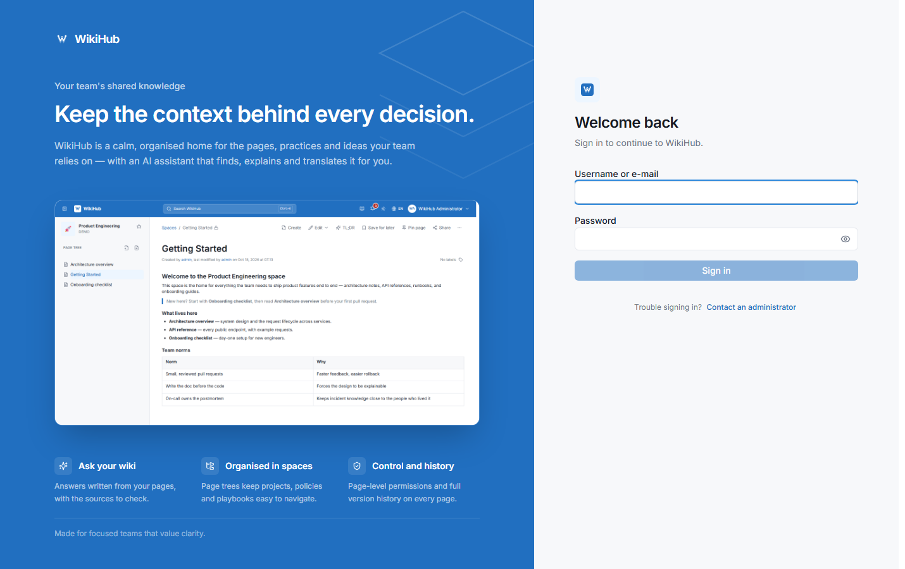

The sign-in screen is in two halves. The cover on the left is in the
workspace's brand colour. It holds the headline, a capture of a real WikiHub
page (the same one shown under [A page, rendered](#a-page-rendered)), and three
features: *Ask your wiki*, *Organised in spaces*, *Control and history*. On a
short window the cover drops the least important text rather than scrolling,
and on a phone only the form is shown.

The form takes a username or an e-mail. **Contact an administrator** opens a
request form for people who cannot sign in. The colour and logo follow
**Administration → Settings → Theme & Branding** (see
[Theme & branding](#theme--branding)); this is the default WikiHub Blue.

## Editing a page

The full path, start to finish: **sign in** (here straight into the space, via
the `?next=` link) → open **Getting Started** from the **page tree** →
**Edit ▾ → Normal editor** → at the end of the page type `/callout` to open the
slash-command menu, pick **Callout: Tip**, and type into it → **Save**. The
toast in the last frame is the real save confirmation.

The **Edit ▾** menu also opens the page as **Markdown source** or **HTML
source**. While editing, the bar above the page has **Live preview**,
**Auto-save on** (the draft is kept on the server as you type), **Save draft**,
**Save** (marked `*` while there are unsaved changes) and **Cancel**. The same
`/` menu inserts headings, tables, code blocks, images, to-do lists, toggles,
dividers, and links to other pages. The in-app **Help** centre has the full
command reference.

## A page, rendered

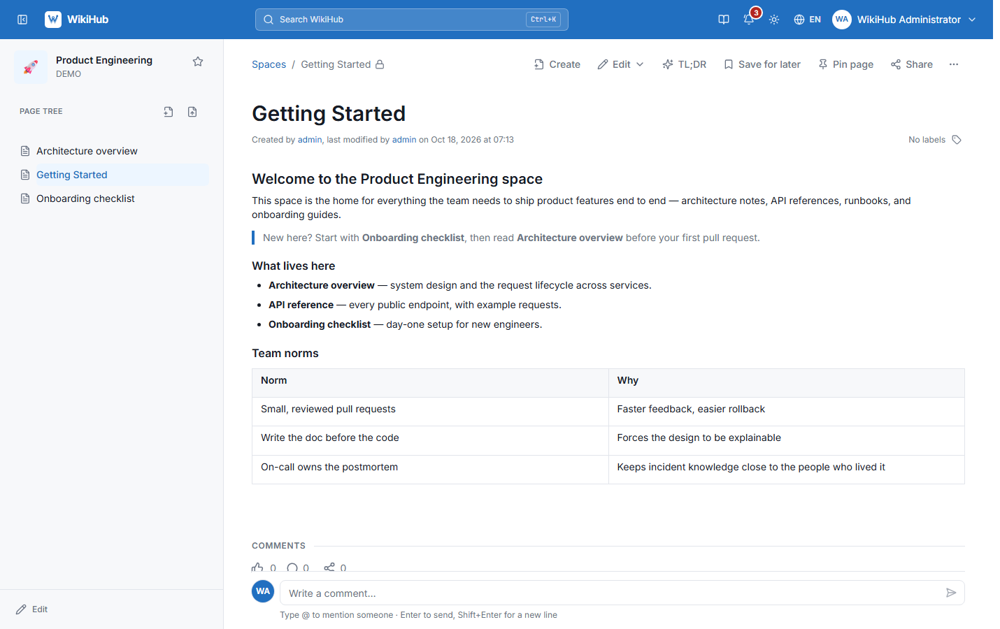

A typical page: headings, a blockquote-style callout, a bulleted list, and a
data table, all in the same document. Above the title sit the page actions:
**Create**, **Edit ▾**, **TL;DR** (an AI summary of the page),
**Save for later**, **Pin page**, **Share** and **⋯** for the rest (move,
history, access, labels, attachments, export, delete). Under the title are who
created and last changed it, and its labels. The foot of the page holds
reactions and comments.

The space's own sidebar shows its identity and its **page tree**. Pages can be
nested arbitrarily deep and moved anywhere, including into another space. The
padlock beside the breadcrumb says the space is Restricted.

The top bar is the same on every screen: the sidebar toggle, the logo,
**Search** (`Ctrl`+`K`), then **Help**, **Notifications** (with an unread
count), **Theme** (light/dark), **Language** (`EN`/`VI`) and the account menu.
When an administrator has set up the AI assistant, a chat button also appears
there.

## Code blocks

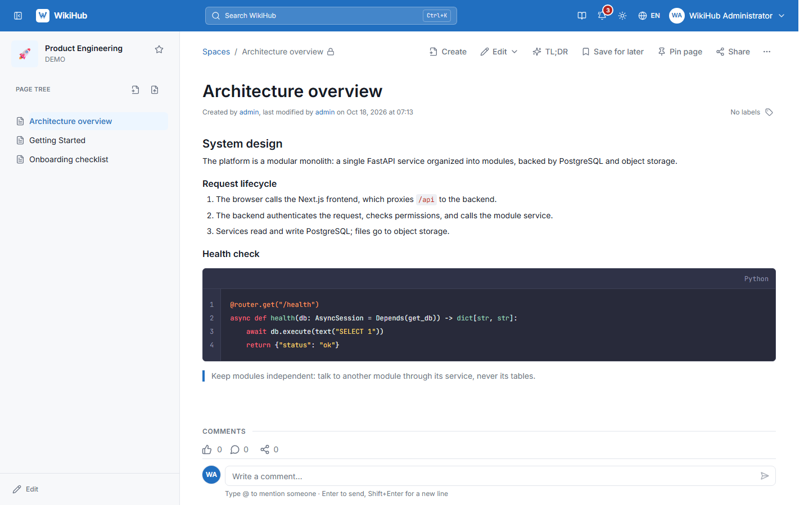

Code blocks get syntax highlighting, line numbers, a language label, and a
one-click copy button. That suits runbooks, architecture notes, and anything
else that mixes prose with real code or config.

## Global search, shortcuts & commands

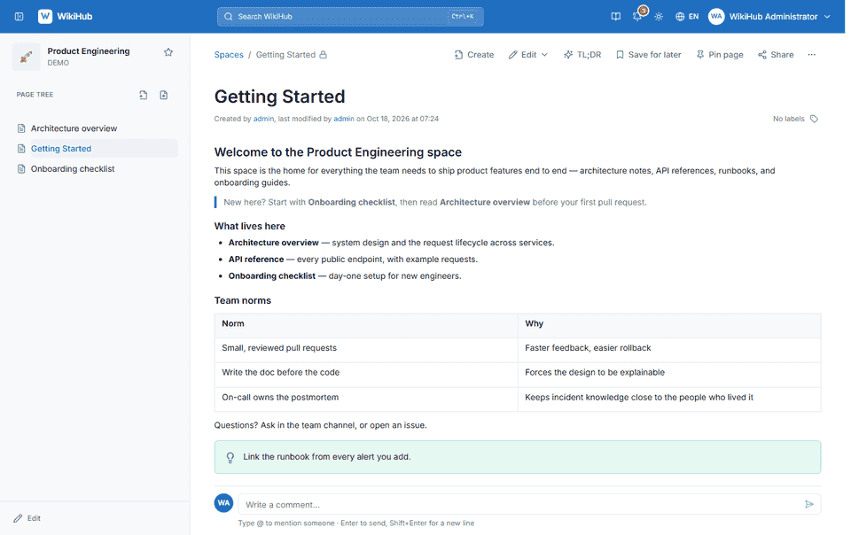

`Ctrl`/`⌘`+`K` from anywhere in the app opens one search box that does three
things.

**Find spaces and pages.** It matches space names, keys and descriptions, and
page titles and content. The matched words are highlighted, and only results
the signed-in user may see are listed. Accents are optional (`tai khoan` finds
*tài khoản*), and common English/Vietnamese pairs count as the same word.

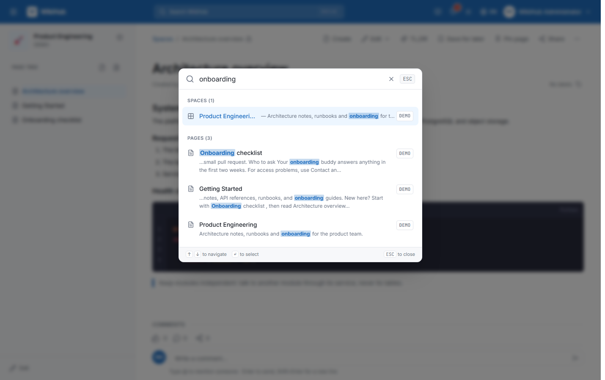

**Go to a place in the app.** The words people use for a task bring up a
**Go to** section above the results: *change password* or *đổi mật khẩu* opens
the password form in your account, *manage users* opens Administration →
Users, *keyboard shortcuts* opens the shortcut settings. Administration
shortcuts appear only for accounts that may open them.

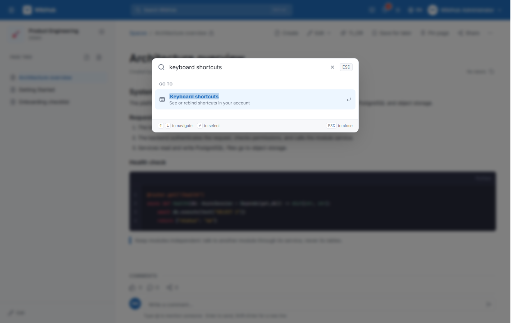

**Run a command.** Starting with `:` turns the box into a command list, and the
wiki is not searched:

| Command | What it does |
| --- | --- |
| `:help` | Open the Help centre; `:help <words>` searches the Help guides |
| `:account`, `:password`, `:security`, `:sessions`, `:shortcuts` | Open that part of your account (`:password` opens the form directly) |
| `:home`, `:spaces`, `:recent`, `:favorites`, `:saved`, `:issues`, `:contact` | Open that page |
| `:chat` | Open the AI chat panel |
| `:ask <question>` | Ask the AI and read the answer in the search box |
| `:users`, `:groups`, `:manage-spaces`, `:manage-issues`, `:stats`, `:server`, `:settings`, `:backup`, `:storage`, `:mail`, `:ai` | Administration pages, for those who may open them |

The first letters are enough (`:he` finds `:help`). `:chat` and `:ask` stay in
the list while the AI assistant is off, greyed out and marked as turned off.

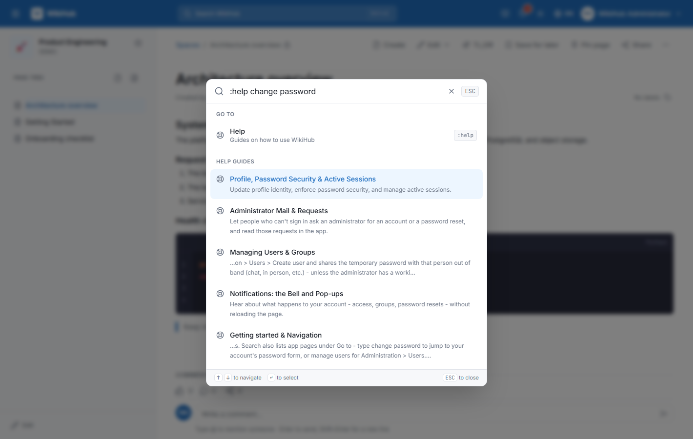

With an AI endpoint configured, the box also offers **Ask AI** for any question
(`Ctrl`+`Enter`). See [AI features](#ai-features).

## Likes, pins & saved-for-later

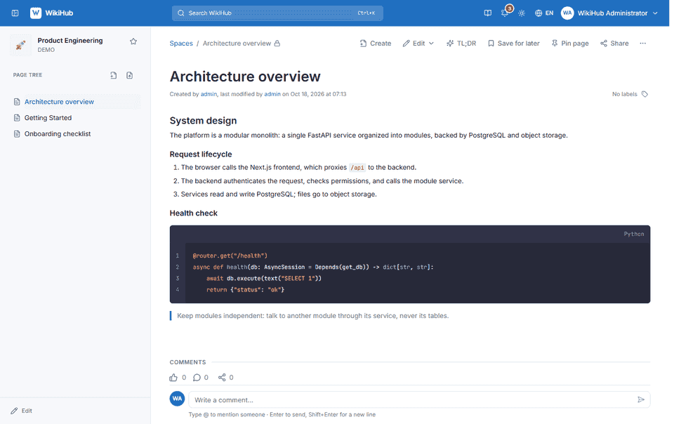

Three lightweight, independent ways to keep track of pages that matter:

- **Like** (the thumb at the foot of the page) flags a page as useful. The count
  is visible to everyone, and clicking it shows who liked it.
- **Save for later** bookmarks a page for yourself. Everything you've saved is
  listed at `/saved`. This one lives in your browser, not your account.
- **Pin page** adds it to **Pinned pages** in the main sidebar, one click away
  from anywhere. **Manage sidebar** chooses which pins and favourite spaces show
  there.

## Drafts & recovery

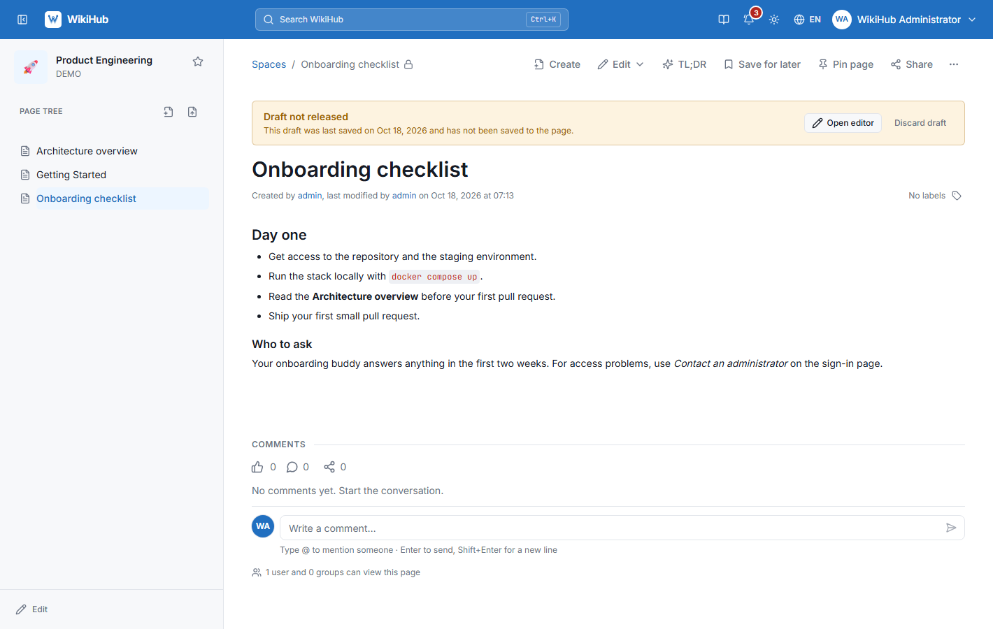

Publishing a page and merely having unsaved changes are two different things.
While editing, an auto-saved draft is kept on the server separately from the
published content. If you navigate away or close the tab before hitting
**Save**, coming back to the page shows this banner, with the date the draft
was last saved, instead of silently losing the edit. **Open editor** resumes
exactly where you left off; **Discard draft** throws it away and keeps the
page as published. If the page has changed since the draft began, the banner
says so.

## Permissions & access control

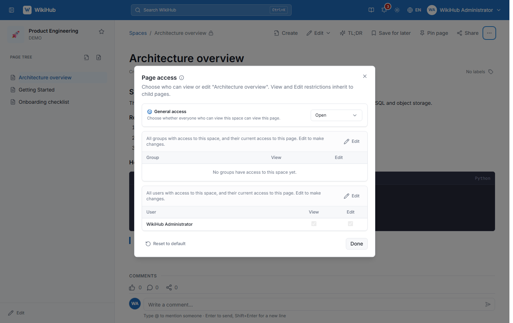

Access can be scoped at the space level or narrowed further on a single page.
**⋯ → Page access** shows **General access** (Open or Restricted) plus exactly
which groups and users can view or edit *this* page. Restricted starts from an
empty allow-list you build up by adding specific people or groups, and View
and Edit restrictions inherit down to child pages. **Reset to default** clears
the page's own allow-list or blocks, after a confirmation. The demo space is Restricted with no groups, so
only its owner is listed here.

The same model applies at the space level, with the full permission set
(`View`, `Add/Edit`, `Delete`, `Delete own`, `Restrictions`, `Move`, `Admin`).
It lives under the space's **Edit** (bottom of its sidebar) or
**Administration → Spaces**, which also has an **Effective permissions**
checker. It resolves exactly what any one person can do without
cross-referencing groups by hand. The foot of every page says how many users
and groups can actually read it.

## Help centre

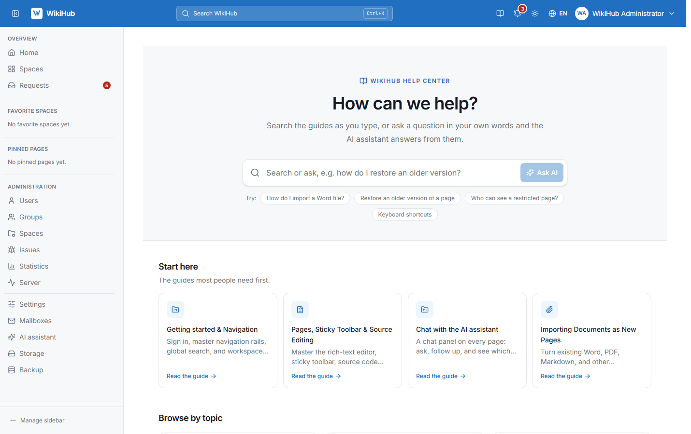

`/help` (the book icon in the top bar, or `:help`) holds the user guide, in
English and Vietnamese. The search box lists matching guides as you type, in
either language and with accents optional. With the AI assistant on,
**Ask AI** answers a whole question from the guides and names the ones to
open; with it off, the button is disabled. **Start here** lists the guides most
people need first, then **Browse by topic** groups the rest. Each guide has its
own page with a navigation of every topic and *Previous* / *Next*.

## Backup & migration

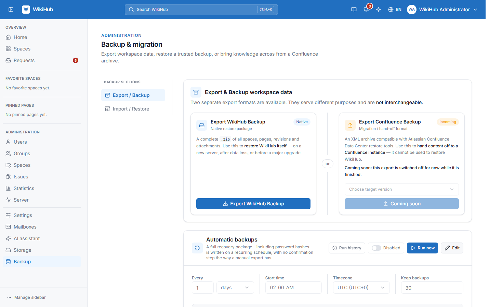

**Export / Backup** offers two formats side by side. A native **WikiHub
Backup** `.zip` restores WikiHub itself. A **Confluence Backup** XML archive
hands content off to a Confluence Data Center instance (one-way; it cannot
restore WikiHub). That export is switched off for now and marked
*Coming soon*. Below them, **Automatic backups** runs a recurring WikiHub
backup on a schedule (every *n* days at a start time and time zone, keeping a
set number), with **Run now**, **Run history** and an on/off switch.
**Import / Restore** restores a WikiHub backup or imports a Confluence export
with a live progress report.

## Theme & branding

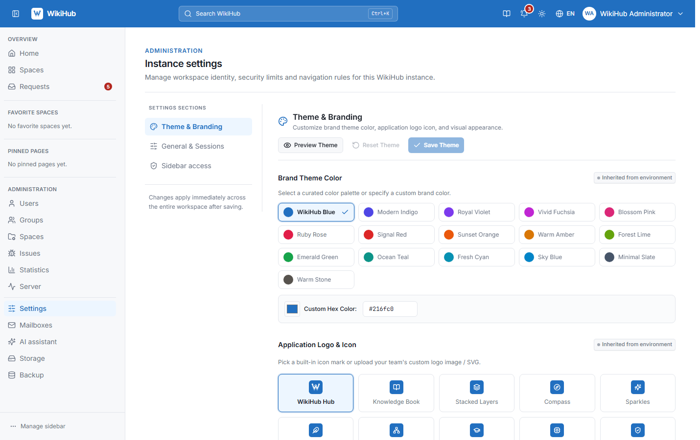

**Administration → Settings → Theme & Branding**: pick a curated colour palette
or a custom hex colour, choose a logo preset or upload your own image or SVG,
and pick the default page typeface. **Preview Theme** shows the result before
**Save Theme** applies it to the whole workspace. A value marked *Inherited
from environment* comes from the server's configuration until it is changed
here. The other sections are **General & Sessions** and **Sidebar access**.

## Language switching

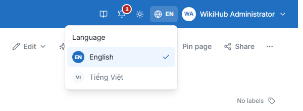

The **EN**/**VI** button in the top bar switches the whole interface between
English and Vietnamese. Every label, button, toast, and validation message
comes from the same translation dictionary, so nothing is left half-translated.
The choice is per-browser (cookie + `localStorage`, no account setting or
server round-trip) and applies instantly, without a page reload. Anything
mid-edit in the page editor survives the switch untouched.

## Small screens

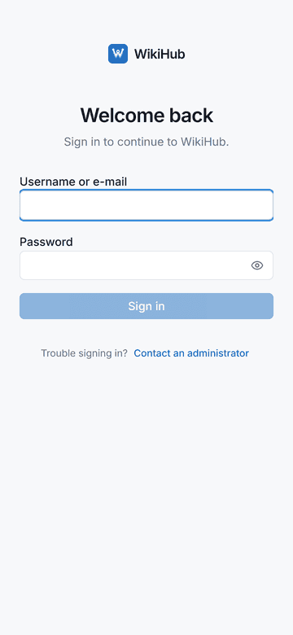

The same sign-in → space → page → edit → save flow at a real phone width
(360×780, Playwright's *Galaxy S24* preset) rather than a scaled-down desktop
layout. The sign-in cover is left out, and the editor's toolbar keeps the basic
formatting buttons and puts the rest behind **⋯**.
The space's page tree has no off-canvas drawer at this width yet, so it stays
above the page content instead of tucking behind a menu button. The account
avatar is cut off at the right edge of the top bar at this width.

## AI features

The AI assistant is optional and uses an OpenAI-compatible endpoint that an
administrator connects under **Administration → AI assistant**. The instance
these captures came from has no endpoint connected, so there are no captures of
AI answers here; showing invented ones would defeat the point of this page.
Without an endpoint every AI control stays visible and says it is not set up,
which is what the greyed **Ask AI** button in the [Help centre](#help-centre)
shows.

What the assistant does is described in the
[main README](../../README.md#-key-features) and in the in-app Help centre:
TL;DR summaries, *Create page with AI*, explaining and translating a
selection, writing in the editor, labels and related pages, **Ask AI** from
search, the chat panel (which knows your account and the Help guides, and can
carry out confirmed actions), optional web search, and semantic search.

---

Want to try it yourself? The [main README](../../README.md#-getting-started)
has the two-command Docker Compose quick start.
